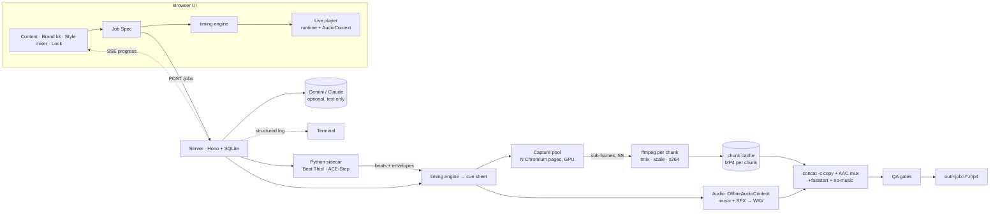

# Reel Studio — Plan

A local web app that turns typed content, logos and colours into kinetic-typography videos. You build the video in the
browser with a live preview, then the render runs in your terminal.

Source spec: `~/projects/dilemaCafe/REEL-PIPELINE.md` (the "spec"). This plan supersedes the spec where they differ.
Each such change is listed in §1.

---

## 1. Decisions

| # | Decision | Why |
|---|---|---|
| D1 | **Own capture worker** (Playwright + Chromium with GPU on, frames piped to ffmpeg). OpenKatana is no longer in the main path | OpenKatana `render_page` is 83 lines of Playwright that run with `--disable-gpu` and write one PNG per frame. That costs 3.6 GB per reel, 231 s per neon chunk, and rules out WebGL. Its timeline render re-writes 2.7 GB of frames to do what `ffmpeg concat` does |
| D2 | **Page contract mirrors HyperFrames' frame adapter** (`ready → seek(t) many times, in any order → destroy`) | HyperFrames (Apache-2.0) stays a drop-in alternative renderer. On macOS its BeginFrame mode is unavailable, so it uses screenshots just like D1 |
| D3 | **TypeScript end to end** (Node 26, pnpm workspace, no build step for packages: Node runs `.ts` natively) | Spec validation, timing engine, cue sheet and styles run unchanged in the live browser preview and in the renderer |
| D4 | **Python only as a `uv` sidecar** for Beat This! (beat/downbeat tracking) and the optional ACE-Step 1.5 add-on | Both are PyTorch/MLX |
| D5 | **No GSAP.** Own pure-`t` motion library (ported from reel9–12) + Anime.js v4 (MIT) where a tween engine helps | GSAP's free license excludes no-code visual animation builders. You may make this public later |
| D6 | **Style = bundle of traits** (§5). 40+ curated presets; combining = trait overrides, a per-section style, or a numeric blend of two styles | Makes 40+ styles maintainable and makes combining styles a first-class feature |
| D7 | **Live in-browser preview** of the same engine and audio graph, scrubbable | Replaces the spec's "stills in 2–5 s"; the terminal render is only needed for export |
| D8 | **One Web Audio graph, two contexts:** real-time `AudioContext` in the preview, `OfflineAudioContext` in the renderer | Preview audio equals rendered audio; full DSP (filters, reverb, compression, sample playback) instead of 4 oscillator waveforms |
| D9 | **Music sources:** sample sequencer (bundled CC0 one-shots), your own track (+ Beat This!), ACE-Step add-on; SFX layer on top of any of them | Your choices. The oscillator synth is dropped |
| D10 | **Cloud LLM (Gemini and Claude, switchable), text-only and optional** | Splits pasted text into sections, suggests emphasis words, ranks styles from the brief. Rendering never calls out |
| D11 | **Quality presets:** draft / standard / final; final = 60 fps + motion blur (sub-frame averaging) + 2× supersampling | Your choices (§8.3) |
| D12 | Content types: event, list/top-N, story/dilemma, lyric (own audio), stats/countdown. Duration 6–30 s | Your choices |
| D13 | Languages: Hebrew (RTL, **with niqqud**), English, mixed he/en in one line | Your choices. Arabic is out of scope for now: per-letter animation breaks joined scripts |
| D14 | Fonts: curated OFL library (Hebrew + Latin, ~20 families, downloaded by `reelgen setup`) + upload your own | Your choice |
| D15 | Single user, localhost. Project lives in `geminiCode/makeAvideo` | Your choice. Hosting is revisited when v1 is done |

Kept from the spec: deterministic output, weekday derived from the date, one cue sheet for animation and music, chunked
parallel render with a content-hashed cache, QA gates, AAC + faststart + a no-music copy, CSP-locked pages with no
network.

---

## 2. Architecture



The **same three packages** (`core`, `timing`, `runtime` + traits) execute in the browser preview, inside the capture
pages, and in the server. This prevents preview/render drift by construction.

---

## 3. Repository layout

```
makeAvideo/
  PLAN.md
  package.json · pnpm-workspace.yaml · tsconfig.json
  packages/
    core/        ✅ scaffolded: Job Spec schema, emphasis parser, derived fields, all cross-package contracts
    timing/      M1  beat grid (generated or detected) → section budget → cue sheet
    runtime/     M1  in-page host: window.REEL, reelPage (seek), channels, unit splitting (Intl.Segmenter + bidi-js), ease/hash
    traits/      M2  trait modules: layout/ unit/ reveal/ motion/ rhythm/ material/ axis/ camera/ background/ transition/ signature/
    styles/      M2  one folder per catalog style: recipe.json + optional signature module + thumb
    audio/       M3  Web Audio graph builders: sequencer presets, SFX map, track playback; offline render helper
    render/      M1  capture pool, ffmpeg pipelines, chunk cache, QA gates
  apps/
    server/      M4  Hono API, job queue, SSE, SQLite (node:sqlite), LLM providers, asset processing
    web/         M4  Vite + React UI
    cli/         M1  `reelgen serve | render <job.json> | setup [fonts|samples|music-ai] | clean`
  sidecar/       M3  uv project: analyze.py (Beat This! + band envelopes), generate.py (ACE-Step, optional)
  assets/        fonts/, samples/ (populated by `reelgen setup`, manifests committed)
  data/          gitignored: brand kits, uploads, jobs, cache, SQLite
```

Packages appear at the milestone that needs them; nothing ships as an empty stub.

---

## 4. Job Spec (single source of truth)

Schema: `packages/core/src/spec.ts` (zod). Summary:

```jsonc
{
  "id": "2026-12-01-dilemma-cafe",
  "language": "he",                       // base direction; mixed he/en runs resolved by bidi per string
  "contentType": "event",                 // event | list | story | lyric | stats
  "brief": "Monthly debate café + jam. Warm, playful.",
  "sections": [
    { "role": "title",    "text": "קפה דילמה וג׳אם" },
    { "role": "tagline",  "text": "הנושאים הכי *מעניינים* ו*חמים* היום!", "style": "glitch-digital" },  // per-section style
    { "role": "datetime", "date": "2026-12-01", "time": "19:30" },
    { "role": "list",     "title": "מה יהיה?", "items": ["דילמות", "ג׳אם", "קפה"] },
    { "role": "stat",     "value": 120, "suffix": "+", "label": "משתתפים" },
    { "role": "endcard",  "logos": ["kiryat-shmona", "ayalim"] }
  ],
  "style": { "base": "kinetic-quote", "blendWith": { "style": "neon-psychedelic", "mix": 0.3 },
             "traits": { "reveal": "typewriter" }, "params": { "energy": 3 } },
  "brandKit": "dilemma-cafe",             // logos + palette + fonts saved once
  "palette": "flamingo-cafe",             // or { "bg": "#…", "text": "#…", "accents": ["#…"] }
  "fonts": { "display": "rubik", "text": "rubik" },
  "music": { "source": "preset", "preset": "lofi-jazz", "bpm": 100, "seed": 1101 },
                                          // | { "source": "track", "file": "…" } | { "source": "ai", "prompt": "…", "bpm": 100 } | { "source": "none" }
  "sfx": true,
  "duration": 26,
  "formats": ["9:16", "1:1"],
  "quality": "standard",                  // draft | standard | final | { fps, motionBlur, supersample }
  "outputs": { "noMusic": true, "keepFrames": false }
}
```

Rules kept from the spec:
- `*word*` marks emphasis.
- `title` and `endcard` are required.
- The style sets max words per section; over-long text produces a split suggestion, never silent shrinking.
- Weekday and date format are derived (locale-aware `Intl`).
- Numbers and times render in LTR-isolated runs.

---

## 5. Style system: traits

### 5.1 Trait axes

A **trait** is one module that controls one dimension of the video. A **style** fills every axis (or uses a *signature*
module that owns several axes).

| Axis | What it decides | Vocabulary (first set) |
|---|---|---|
| `layout` | where units live on screen / in the world | `center-stack`, `justified-block`, `world-canvas` (continuous camera), `grid-reflow`, `split`, `scroll-column`, `marquee-bands`, `path`, `z-depth`, `fill-frame` (fluid), `cards` |
| `unit` | animation granularity | `line`, `word`, `grapheme` (niqqud stays on its letter), `glyph-outline` (vector paths for morph/path/3D) |
| `reveal` | how units enter/exit | `cut`, `fade`, `mask-slide`, `mask-rise`, `typewriter`, `scramble`, `slot`, `flap`, `draw-stroke`, `stamp`, `highlight-sweep`, `particle-assemble`, `morph-from-previous` |
| `motion` | easing character / physics | `functional` (linear/quad), `smooth` (expo), `overshoot` (back), `spring` (organic), `elastic`, `snap` (no easing, brutal), `drift` (noise) |
| `rhythm` | what drives timing | `time`, `beat`, `downbeat-accent`, `audio-reactive` (per-frame band envelopes) |
| `material` | fill and surface | `flat`, `outline-fill`, `gradient`, `neon-glow`, `chrome`†, `grain-paper`, `halftone-riso`, `chalk`, `sticker`, `extrude`† |
| `axis` | variable-font animation | `none`, `weight-wave`, `width-breath`, `emphasis-weight` |
| `camera` | view transform | `static`, `pan-turn`, `push-zoom`, `shake`, `orbit`†, `fly-through`† |
| `background` | scene behind the type | `solid`, `paper-grid`, `starfield`, `panels`, `blobs`, `grid-scroll`, `flow-field`, `stage-light` |
| `transition` | between sections | `cut`, `panel-wipe`, `camera-move`, `morph`, `whip`, `flash`, `fold`† |

† needs the WebGL layer (three.js + troika-three-text).

### 5.2 Composition mechanism: channels, not style strings

Traits never write CSS directly. Each frame, every unit has a channel record:

`tx ty tz sx sy rot skew opacity blur clip(0..1, side) color fillProgress strokeProgress wght wdth glow z`

Per-frame order: `rhythm → camera → layout → reveal → motion (re-times reveal progress) → axis → material → background →
transition`. Each trait **adds or multiplies** into channels. One `commit` step writes them to the DOM or the WebGL
layer. This is what makes `reveal: typewriter` combine with `material: neon-glow` and `rhythm: audio-reactive` without
either module knowing about the others.

### 5.3 The three ways to combine (your choices)

1. **Trait override:** `style.traits = { reveal: "typewriter" }` on top of a base style.
2. **Per section:** `section.style` resolves its own recipe. The incoming section's `transition` trait bridges the two.
3. **Blend:** `blendWith: { style, mix }`. Numeric params lerp: energy, shake, glow, speed, density, easing sharpness,
   overshoot. Discrete traits come from the dominant style (`mix < 0.5` → base).

**Compatibility:** each trait declares `requires` / `excludes`, e.g. `unit: grapheme` excludes `reveal: morph-from-previous`,
and `layout: world-canvas` requires `camera: pan-turn | push-zoom`. The UI greys out invalid picks and explains why;
the server rejects invalid specs.

### 5.4 Render layers

- **DOM** is the default: crisp text and native Hebrew shaping.
  - **Unit splitting (M0c):**
    1. Lay out the *unsplit* line.
    2. Measure each grapheme/word with `Range.getBoundingClientRect`.
    3. Absolutely position one span per unit, carrying its own bidi-js level/`dir` and anchored at its start edge.
    
    This measured ≤ 0.84 % / 0 px off the unsplit text. **Never** use naive `inline-block` units: they lose kerning
    (up to 13.9 px) and reverse numbers/Latin inside Hebrew (`03:91`).
  - Traits that must reflow per frame (`axis: weight-wave`) use nested `unicode-bidi:isolate` spans with kerning
    compensation.
  - Sequential reveals use logical order; spatial sweeps use measured x.
- **Canvas2D** for particles and textures. Requires `fontKerning = 'normal'`.
- **WebGL** for `†` traits. Units are laid out in the DOM, then painted at the measured positions with troika-three-text
  (one `Text` per unit in a `BatchedText`, ~0.9 ms/frame for 35 units). Troika needs:
  - a **bundle-time patch** (`spikes/text/troika-patch.ts`). Stock troika mirrors niqqud marks in RTL runs, up to
    65 px off.
  - `useWorker: false`, because the worker hangs under our CSP.
  - a cmap preflight, because a missing glyph makes it fetch a CDN fallback and hang.
  - **static per-weight font instances**, because it ignores variable axes.
  
  The no-patch fallback is a Canvas2D texture per unit (≤ 9.4 % / ≤ 1 px).
- **`axis` traits are DOM-only** (troika ignores variable axes). In WebGL, weight changes come from harfbuzz outlines.
- **Glyph outlines** come from **harfbuzzjs**, which shapes Hebrew with niqqud correctly (M0d: niqqud within 0.77 px
  of Chromium; `setVariations` for weight).
- **Morphs** use our own contour matcher after a nonzero boolean union (`polygon-clipping`); flubber failed (M0d).
  `morph-from-previous` is limited to same-script pairs of similar length; otherwise it falls back to a crossfade.
- Path text places glyphs from harfbuzz advances, not SVG `textPath`, which is unreliable for RTL.

---

## 6. Style catalog (54; R1 = first release)

Your first-release families: motion, beat/audio-reactive, reveal, dynamic layout, fluid, spatial/3D, morph, high-energy.
✅ = a reference engine exists in dilemaCafe (reel9–12) and gets ported.

| # | id | Families | Signature look / motion | E | R1 |
|---|---|---|---|---|---|
| 1 | ✅ `kinetic-quote` | motion, dynamic layout | cream paper, justified blocks, one continuous camera with 90° turns | 2 | R1 |
| 2 | ✅ `neon-psychedelic` | high-energy, textured | starfield, rainbow neon, slam + RGB split, shake | 5 | R1 |
| 3 | ✅ `swiss-title-reveal` | reveal, motion | colour-panel wipes, baseline mask rise, odometer digits | 4 | R1 |
| 4 | `word-per-beat` | beat, high-energy | one huge word per beat, bg colour swap per cut | 5 | R1 |
| 5 | `brutalist` | high-energy, motion | giant cropped type, no easing, hard cuts | 5 | R1 |
| 6 | `sticker-pop` | motion, high-energy | stickers bounce in with overshoot, peel-off exits | 4 | R1 |
| 7 | `bass-pulse` | audio-reactive | scale/weight/glow follow the bass envelope | 4 | R1 |
| 8 | `equalizer-type` | audio-reactive | letters stretch like EQ bars from band energies | 4 | R1 |
| 9 | `lyric-karaoke` | beat, reveal | colour-fill sweep per word on its (tapped/aligned) time | 2 | R1 |
| 10 | `typewriter-terminal` | reveal | per-grapheme typing, cursor, glitch on emphasis | 2 | R1 |
| 11 | `mask-slide` | reveal, simple | clean directional masks, functional easing | 2 | R1 |
| 12 | `split-flap` | reveal | departure board flips, date row | 3 | R1 |
| 13 | `scramble-decode` | reveal, generative | glyph scramble resolves into text (Hebrew/Latin sets) | 3 | R1 |
| 14 | `grid-reflow` | dynamic layout | words re-flow between grid cells per section (FLIP) | 3 | R1 |
| 15 | `bento` | dynamic layout | content tiles resize/re-pack per section | 3 | R1 |
| 16 | `versus-split` | dynamic layout, narrative | split slams, A vs B, centre badge | 4 | R1 |
| 17 | `fluid-scale` | fluid typography | every line fills the width; size flows continuously with content | 3 | R1 |
| 18 | `elastic-stretch` | fluid & organic | squash/stretch springs, gooey settle | 3 | R1 |
| 19 | `liquid-morph` | morph, fluid & organic | gooey blobs carry and morph into words | 2 | R1 |
| 20 | `glyph-morph` | morph | letters morph outline-to-outline into the next word | 3 | R1 |
| 21 | `shape-to-type` | morph | circles/squares morph into letters | 3 | R1 |
| 22 | `extrude-3d` | spatial | extruded glyphs, orbiting camera | 4 | R1 |
| 23 | `z-tunnel` | spatial, high-energy | fly through words placed in depth | 4 | R1 |
| 24 | `isometric-blocks` | spatial | text on cube faces, 90° camera rotation | 3 | R1 |
| 25 | `card-deck-3d` | spatial, narrative | cards deal, flip, fly off (questions/lists) | 3 | R1 |
| 26 | `stacked-scroll` | scrolling, rhythmic | repeated lines, speed ramps, emphasis freezes | 4 | |
| 27 | `credits-roll` | scrolling, simple | smooth vertical roll, held highlights | 2 | |
| 28 | `ticker-bands` | scrolling, high-energy | crossing diagonal marquees stop on key info | 5 | |
| 29 | `infinite-zoom` | scrolling, spatial | Droste zoom through nested text frames | 4 | |
| 30 | `editorial-magazine` | dynamic layout | columns, drop caps, page-turn wipes | 2 | |
| 31 | `tile-mosaic` | dynamic layout | tiles flip to letters, ripple waves | 4 | |
| 32 | `ribbon-path` | path | text flows along a curving ribbon | 3 | |
| 33 | `orbit-ring` | path | text orbits rings around the logo | 3 | |
| 34 | `map-route` | path, narrative | route draws to the venue pin | 2 | |
| 35 | `paper-fold` | spatial | panels unfold to reveal sections | 2 | |
| 36 | `weight-wave` | variable-font | `wght` wave travels across letters on the beat | 3 | |
| 37 | `width-breath` | variable-font, fluid | slow `wdth`/`wght` breathing | 1 | |
| 38 | `chrome-liquid` | textured | chrome sheen shader sweep | 4 | |
| 39 | `risograph` | textured | halftone, misregistration kicks on beats | 3 | |
| 40 | `chalkboard-cafe` | textured | chalk draw-on, dust puffs, menu board | 2 | |
| 41 | `cutout-collage` | textured, high-energy | ransom-note letters, tape slaps | 4 | |
| 42 | `particle-assemble` | generative | particles form words, disperse on exit | 4 | |
| 43 | `flow-field` | generative, fluid & organic | letters drift on a seeded noise field | 2 | |
| 44 | `glitch-digital` | generative, high-energy | slice displacement, RGB split, stutter holds | 5 | |
| 45 | `minimal-luxe` | simple | negative space, tracking-in, hairline rules | 1 | |
| 46 | `functional-clean` | simple | readable fades/slides, accessibility-first | 1 | |
| 47 | `coffee-steam` | fluid & organic | steam wisps, blob morphs, latte-art reveals | 1 | |
| 48 | `retro-80s` | high-energy, textured | sunset grid, chrome text, VHS jitter | 4 | |
| 49 | `y2k-bubble` | high-energy | inflated gradient letters, sparkles | 4 | |
| 50 | `countdown` | stats, high-energy | numbers count down to the date, final slam | 4 | |
| 51 | `stat-counter` | stats, dynamic layout | numbers count up, bars grow, labels land | 3 | |
| 52 | `dilemma-reveal` | narrative | question → two options split → tension → reveal | 3 | |
| 53 | `chat-bubbles` | narrative | messenger UI, two sides argue | 3 | |
| 54 | `list-stack` | narrative, dynamic layout | numbered top-N items push and stack | 3 | |

Every style is a `recipe.json` (traits + params + defaults + constraints); a few are signature modules (#12, #34,
#53, #54). All styles must pass QA on a shared test-spec set: event he, event en, list, stats, mixed he/en with niqqud,
every format.

---

## 7. Timing engine and cue sheet

1. **Grid source:**
   - Generated music: `beat = 60/bpm`, `T0 = 0.5 s`.
   - Own track or AI music: beats/downbeats from Beat This! (`final0` model; handles tempo drift), plus per-frame band
     envelopes (`sub, bass, mid, high, onset`) at the output fps.
     - M0f measured beat F 0.989–1.000 and downbeat F 1.000 on the three dilemaCafe reels, within ±1 frame at 60 fps.
     - Trust downbeats only when `meter_confidence ≥ 0.8`; otherwise use beats alone.
     - Trim phantom beats at the edges (the model keeps beating about 1 s into a held final chord).
2. **Section budget** (as in the spec): `max(minHold, words·perWord + entry + exit)` beats → snapped to downbeats →
   holds scaled to fit `duration`, never entries. End card ≥ 2.5 s.
3. **Lyrics:**
   - Tap-to-align in the UI: press space per word during playback, then snap to the nearest onset.
   - Optional per-line manual times.
   - (ASR alignment of sung Hebrew is unreliable, so it is not planned.)
4. **Cue sheet** = timed events (`section-in/hold/out`, `land`, `emphasis`, `beat`, `downbeat`, `slam`, `wipe`,
   `camera-move`, `slot-start/land`, `drop`, `endcard`) + the envelopes.
5. It feeds three consumers:
   - the page (`window.REEL.cues`)
   - the audio graph (cue → SFX/stinger; generated music arranges around section cues)
   - the QA gates (hold times)
6. **Numeric rule (M0d):** `Math.sin/cos/atan2/exp/log` give bitwise-different results in Node and Chromium, while
   `+ − × ÷ sqrt pow hypot` match. Therefore:
   - the timing engine (which runs in both the UI and the server) uses only the bit-exact operations;
   - all eased and per-frame values are computed **in the page only**, never precomputed in Node.

---

## 8. Render pipeline

### 8.1 Capture worker (`packages/render`)
- **Server:** a loopback HTTP server serves the job's bundle dir with the spec's CSP (`default-src 'self'`, inline
  allowed). Any off-host request is aborted.
- **Inputs:** `window.REEL` is injected via `addInitScript`, so no wrapper HTML files. `Math.random` is seeded per frame
  (kept from OpenKatana).
- **Pool:** 4 browsers (`chrome-headless-shell`), each rendering one chunk in order. Chunk = 300 frames at 30 fps
  (10 s), with fixed boundaries. M0: one page survives ≥ 780 frames when frames are streamed.
- **GPU** is on: `--use-angle=metal --enable-gpu-rasterization --ignore-gpu-blocklist` (M0a: Metal WebGL2 on M1 Pro).
- **Determinism**, replacing OpenKatana's forward/reverse hash check (M0a: on GPU, render order leaves ≤ 2/255
  residue):
  - **(a)** 3 sampled frames re-rendered in chunk order in a fresh browser must hash identically;
  - **(b)** a reverse-order check with tolerance max Δ ≤ 2/255.
- **Frame flow:** per frame (or sub-frame) → `reelPage.seek(t)` → double rAF → CDP `Page.captureScreenshot`
  (`optimizeForSpeed`, `clip.scale` = supersample factor; CDP ignores `deviceScaleFactor` otherwise) → piped into that
  chunk's ffmpeg stdin. JPEG q95 is the default intermediate; PNG is opt-in. **No frame files on disk.**
  `page.screenshot` is 5–16× slower and must not be used.
- **Encode per chunk:**
  - draft: `h264_videotoolbox`
  - standard: x264 `medium` CRF 18
  - final: x264 `slow` CRF 14
  
  All use `yuv420p`, BT.709 tags and a closed GOP. Chunks join with `concat -c copy`. Pin the Chromium build and
  include it in the cache key.
- **Measured (M0):** a full 26 s reel at standard takes **16 s** (flat) and **42 s** (neon) on 4 workers. OpenKatana
  took ~100–450 s for the same reels and wrote 3.6 GB of frames.

### 8.2 Audio
`packages/audio` builds the graph from `{music, sfx, cues}`.

- **Preview** plays the plain single graph in a real-time `AudioContext`.
- **Render** uses **stem passes** (M0e). A single graph is *not* bit-deterministic: Chromium sums overlapping inputs
  in a varying order, leaving drift of about −133 dBFS. Instead:
  - each instrument group renders alone in its own `OfflineAudioContext`
  - stems are summed in JS in a fixed order
  - each bus effect (reverb send, master compressor/limiter) runs as its own pass with one buffer input
  
  Measured: 1 hash across 8 renders, 4 launches and 2 Chromium builds, in about 2 s for 26 s.
- ffmpeg then:
  - encodes AAC 256k,
  - loudness-normalises to −14 LUFS integrated, peak ≤ −1 dBTP (`loudnorm`, two-pass),
  - writes the `-no-music` copy (SFX only, or silent if the user chooses).
- QA gate: render the audio twice and require identical hashes (about 2 s).

### 8.3 Quality presets

| Preset | fps | Motion blur | Supersample | Use |
|---|---|---|---|---|
| draft | 30 | — | 1× | quick check, ~real time for flat styles |
| standard | 30 | — | 1× | default export |
| final | 60 | 6 sub-frames, 180° shutter | 2× | hero export |

- **Motion blur:** sub-frames at `t = (f + (s+0.5)/S·shutter − shutter/2)/fps` stream to ffmpeg at `fps·S`, then
  `tmix=frames=S, select='eq(mod(n,S),S-1)', setpts=N/(fps*TB)`. Verified in M0b: exact frame counts and visible
  directional blur (`spikes/capture/out/motion-blur-sheet.png`).
- **Supersampling:** capture `clip.scale = 2`, then `scale=W:H:flags=lanczos`.
- **Measured cost (M0):** final ≈ 12–15× the wall time of standard (35–44 s per video-second on one worker).
  - Full 26 s flat reel at final on 4 workers: **201 s**. Heavy styles: ~4–6 min [INFERENCE].
  - A "fast final" with 4 sub-frames saves 32 %.
  - Final is opt-in per export, and its chunks are cached.

### 8.4 Cache and cleanup
- **Chunk key:** `sha256(runtime + traits + style bundle hashes, fonts/assets hashes, resolved inputs that affect the
  chunk, cues ∩ chunk window, format, quality, frame range)`.
- Styles declare `globalLayout: true` when layout depends on all sections (e.g. `kinetic-quote`'s world canvas). For
  those, every section's text is in every key. Otherwise only sections overlapping the chunk are.
- Chunk MP4s are small. Disk per job ≈ final MP4s + chunk cache (tens of MB). `reelgen clean` prunes the cache by
  LRU/age.

### 8.5 Terminal UX
`reelgen serve` (UI + worker) and `reelgen render job.json` (headless) print the spec's structured lines: spec, audio,
per-format chunk bars with cached marks, determinism, concat, export, QA.

---

## 9. Web UI

| Screen | Contents |
|---|---|
| Content | Content-type picker. **Paste anything** → LLM split into sections with suggested emphasis (editable chips). Or a manual section list with role-specific fields: date picker shows the derived weekday; list items; stat value/suffix |
| Brand kit | Drop logos (PNG/SVG):<br>• flat-background removal by flood fill + trim (no AI)<br>• palette auto-extracted (k-means)<br>• font pick<br>• saved and reusable |
| Style | Search/filter grid of 54 styles by family/energy/background. Each card is a **live mini-player with your own text**. LLM "suggest from brief" ranks them |
| Mixer | Base style, trait overrides (per axis, invalid options greyed out with a reason), blend partner + slider, per-section style assignment on a section strip |
| Look | Palette (kit, catalog or custom + contrast check), fonts, music source (preset/BPM, upload track → analysis, AI prompt), SFX on/off, duration, formats, quality preset |
| Preview | Full live player: scrub, play with audio, format switcher, Instagram safe-area overlay, QA warnings pinned to the timeline, inline text edits |
| Render | Queue, SSE progress bars (mirrors the terminal), results per format: MP4, no-music MP4, thumbnail, open folder. Job history; duplicate a job |

---

## 10. QA gates

From the spec: determinism, text in safe area at every hold (per format), overlaps, content fidelity (NFC, emphasis
stripped, **niqqud preserved**), weekday/date, seams (now chunk-boundary pixel diff of the encoded output), audio
length = frames/fps, container (`ffprobe`), WCAG contrast ≥ 3:1.

New:
- loudness −14 LUFS ±1
- font glyph coverage: every character in the spec exists in the chosen font (a hard **fail**). Otherwise tofu
  appears in the DOM, and troika hangs fetching a CDN fallback (M0c).
- trait compatibility check

---

## 11. Fonts, samples, LLM

- **Fonts:** `reelgen setup fonts` downloads the curated OFL set from the `google/fonts` GitHub repo into `assets/fonts/`.
  A committed manifest lists files, SHA-256, axes and scripts.
  - Uploads are checked for Hebrew coverage (cmap) and axes.
  - Setup also builds **static instances** per weight in use (fonttools `varLib.instancer` via `uvx`) for the WebGL
    layer, which ignores variable axes (M0c).
  - **Limitation:** most Hebrew variable fonts only have `wght`; `wdth` exists in Noto Sans Hebrew and Open Sans.
    `width-breath` therefore filters its font list.
- **Samples:** `reelgen setup samples` downloads CC0 one-shot packs (drums, plucks, keys, bass, risers, impacts). The
  manifest records each pack's licence.
- **Analysis sidecar** (`sidecar/`, uv, Python 3.12, about 720 MB venv):
  - Beat This! `final0` (81 MB) is downloaded by `reelgen setup` and checked against its SHA-256, because the library
    otherwise fetches it at runtime.
  - It runs on CPU: about 2 s per 26 s clip and 6 s per 3 min track. MPS is only worth it for long tracks.
  - The CLI and JSON contract come from `spikes/beats/analyze.py`.
  - Beats are cached by audio SHA-256 + model version; envelopes additionally by fps/offset/duration.
  - The output is byte-deterministic.
- **LLM:** `apps/server/llm/{gemini,claude}.ts` behind one interface:
  - `splitContent`
  - `suggestEmphasis`
  - `rankStyles`
  - `proposeAIMusicPrompt`
  
  All return JSON-schema-validated output. Keys go in `.env`. Every LLM feature is optional, and the UI works
  without keys.

---

## 12. Milestones

| M | Deliverable | Accept when |
|---|---|---|
| M0 | ✅ **Spikes done** (2026-11-23). Results in `spikes/results/`: `capture.md` (a+b), `text.md` (c), `morph.md` (d), `audio.md` (e), `beats.md` (f) | Every spike PASS or PASS WITH CAVEATS; plan adjusted in §5.4, §7, §8, §10, §11, §13 |
| M1 | `core` + `timing` + `runtime` + `render` + `cli`. `kinetic-quote` ported as one monolithic style | `reelgen render examples/dilemma.json` reproduces the spec §13 (9:16 + 1:1, 26.000 s, AAC, QA pass) with no manual steps. Date-only edit re-renders only affected chunks |
| M2 | Trait system + channels + compat. All three ✅ engines decomposed into traits; per-section styles; blend | The 3 styles render the test-spec set in all formats. One trait-override and one blend example render |
| M3 | Audio: sequencer + 4 presets + SFX map + own-track analysis (sidecar) + audio-reactive envelopes | Own MP3 → text lands on detected downbeats (±1 frame); preview and render audio hashes match |
| M4 | Server + Web UI (all screens) + SSE + brand kits + LLM providers | You go from pasted text and dropped logos to a finished MP4 without touching files |
| M5 | Quality presets (60 fps, motion blur, 2× SS), cache, cleanup, multi-format | Final preset renders; disk after a job < 100 MB excluding outputs |
| M6 | **R1 catalog**: styles #1–#25 | Each passes QA on the test-spec set in its formats |
| M7 | Catalog to 54, ≥10 music presets, ACE-Step add-on (`reelgen setup music-ai`) | Same QA bar |
| M8 (opt.) | A4 flier, alpha (ProRes 4444) / GIF outputs | |

---

## 13. Risks

| Risk | Mitigation |
|---|---|
| ~~Headless Chromium on macOS may not use the GPU~~ | **Retired (M0a):** `chrome-headless-shell` + GPU flags gives ANGLE Metal |
| GPU raster leaves ≤ 2/255 order-dependent residue | Fixed chunk boundaries and order; two-part determinism gate (§8.1) |
| Web Audio single-graph mixing is not bit-deterministic | Stem-pass render (§8.2) |
| Arbitrary trait combinations can look bad even when valid | Curated presets are the default path; the mixer shows a live preview; compat rules grow from QA findings |
| Partial cache invalidation for global-layout styles | `globalLayout` flag (§8.4); correctness over cache hits |
| troika: niqqud mirrored, worker/CDN hangs, no variable axes (confirmed M0c) | Patched build + `useWorker:false` + cmap preflight + static instances; Canvas2D fallback. Re-verify the patch on every troika upgrade, or upstream it |
| Morphs between different scripts or letter counts look blobby (M0d) | Compat rule limits `morph-from-previous`; crossfade fallback |
| Final-quality render time | Measured 201 s for a flat 26 s reel on 4 workers (M0a); heavy styles about 4–6 min [INFERENCE]. Cache, opt-in final, "fast final" with 4 sub-frames |
| ACE-Step install size and quality | Optional add-on; output goes through the same beat analysis |

## 14. Open items for you
- Reference videos/accounts for the catalog's look (you'll send them later).
- Current Instagram safe-area insets per format (verify against the app before M6).
- Approve the curated font list and sample packs when M3/M4 propose them.
